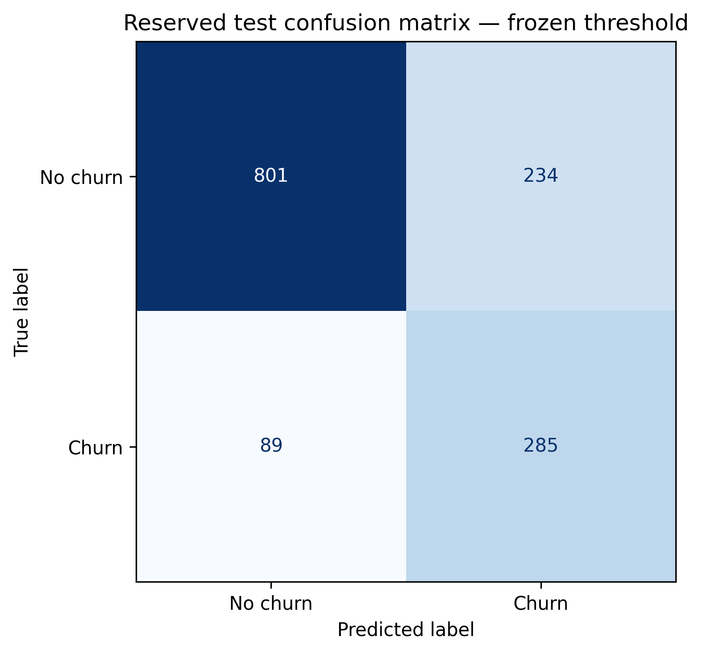
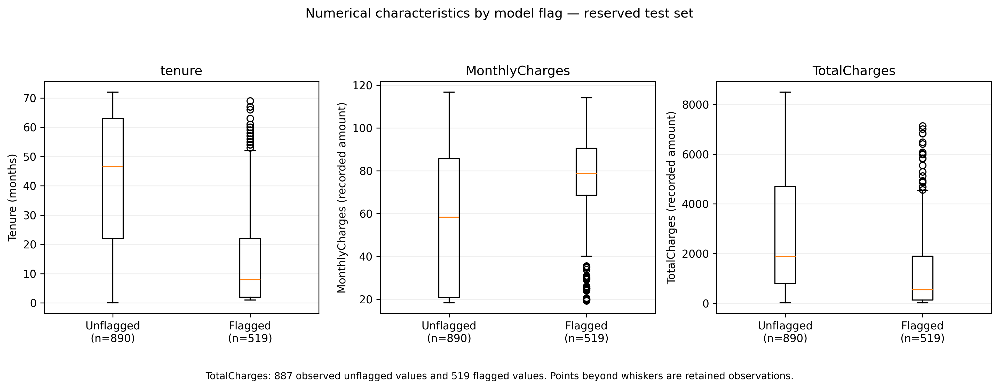

# Telco Customer Churn Classification and High Risk Profiling

**Does a more complex model perform better and what does its customer shortlist mean?**

A four-member IT3091 Machine Learning project (Group 2026-DS-77) using 7,043 customer records. We compared model families, selected a decision threshold using development data, evaluated a frozen procedure on reserved records, and described the flagged customers. This is an academic classification study, not a deployed retention system.

## Results at a glance

| Reserved-test metric | Estimate | Approximate 95% bootstrap interval |
|---|---:|---:|
| Average Precision | 0.6565 | 0.6070–0.7087 |
| Precision | 0.5491 | 0.5063–0.5927 |
| Recall | 0.7620 | 0.7191–0.8042 |
| F1 | 0.6383 | 0.6014–0.6748 |

The forest flagged **519 of 1,409 customers**: 285 recorded churners and 234 recorded non-churners. It missed 89 churners and correctly left 801 non-churners unflagged. The threshold was fixed at **0.319015704046037** before test evaluation.

## My contribution and team credit

The portfolio owner is **IT24103677, group leader**. My main technical contributions were handover and data-integrity checks, reserved-test evaluation, flagged/unflagged profiling (Notebook 04), and the supplementary bootstrap analysis (Notebook 05). I also coordinated the shared evidence and final report. This repository represents collaborative work, not a solo implementation.

| Contributor | Main responsibility |
|---|---|
| IT24103677 | Leadership, final evaluation, profiling, uncertainty analysis and integration |
| IT24102420 | Data verification, split, EDA and data dictionary |
| IT24103676 | Preprocessing, diagnostics and shared pipeline code |
| IT24102789 | Model comparison, tuning, threshold selection and fitted-model handover |

## Technical approach

1. Verify the source and preserve an 80/20 stratified split: 5,634 development and 1,409 test customers.
2. Explore development data and document quality issues. TotalCharges contained eight development blanks and three test blanks.
3. Use complete scikit-learn pipelines: fixed parsing, training-fitted median imputation, one-hot encoding, and StandardScaler for logistic regression only.
4. Compare a dummy-prior baseline with logistic regression, a shallow decision tree and Random Forest. Run an exhaustive, manually implemented grid search of **26 configurations across five shared stratified folds** (130 tuning fits).
5. Compare balanced versus unweighted class settings; select by highest unrounded mean validation Average Precision. No training resampling was performed.
6. Generate selected-configuration out-of-fold development scores and maximise pooled F1 to choose the operating threshold.
7. Freeze the procedure, fit on all development records, verify the saved artifact, then evaluate without fitting or tuning on test data.
8. Describe the flagged group and quantify conditional test-sample uncertainty with **10,000 paired customer-row bootstrap resamples**.

## Model comparison

| Model | Best mean validation AP |
|---|---:|
| Dummy prior | 0.2654 |
| Logistic regression | 0.6607 |
| Shallow decision tree | 0.6124 |
| Random Forest | 0.6662 |

The forest used 200 trees, maximum depth 10, minimum leaf size 10 and no class weighting. Logistic regression used L2 regularisation; C was tuned. The forest's development advantage was small and statistical superiority was not established. Training-versus-validation results were inspected for overfitting; the selected forest retained a gap.

[Full tuning results](outputs/tables/tuned_model_cv_all_configurations.csv) · [Comparison summary](outputs/tables/model_selection_comparison.csv) · [Final test summary](outputs/tables/final_evaluation/final_test_summary.csv)

## Customer profiling

Flagged customers had median tenure of 8 months versus 46.5 months for unflagged customers, and median MonthlyCharges of 78.75 versus 58.35 (recorded amounts; currency not established). Month-to-month contracts represented 98.65% of the flagged group versus 29.33% of the unflagged group.

These are descriptive group differences, not causal effects or feature-importance estimates. The individual characteristics were summarised separately, not established as a single combined segment. Missing amounts remained missing in descriptive summaries while the fitted pipeline handled them for prediction.

## Explore the project

| File or folder | Purpose |
|---|---|
| [Notebook 01](notebooks/01_data_verification_split_eda.ipynb) | Source verification, split, EDA and dictionary |
| [Notebook 02](notebooks/02_preprocessing_feature_engineering.ipynb) | Preprocessing and diagnostic checks |
| [Notebook 03](notebooks/03_model_development_comparison.ipynb) | Model comparison, tuning, thresholding and handover |
| [Notebook 04](notebooks/04_final_evaluation_and_profiling.ipynb) | Final evaluation and profiling |
| [Notebook 05](notebooks/05_frozen_model_uncertainty.ipynb) | Additional uncertainty analysis |
| [Shared preprocessing](src/telco_preprocessing.py) | Reusable input validation and pipeline factory |
| [Data dictionary](outputs/tables/development_data_dictionary.csv) | Documented meanings, development observations and handling |
| [Final report](report/2026-DS-77%20Final%20Report.pdf) | Full methods, reasoning, recommendations and limitations |
| [Technical logs](logs/) | Group decisions, EDA and preprocessing reasoning |
| [Frozen model](models/) | Fitted pipeline, procedure and historical handover record |
| [Uncertainty evidence](outputs/tables/final_evaluation/uncertainty_analysis/) | Saved bootstrap runs and confidence intervals |

## Reproduction

**Read the executed notebooks without rerunning them to inspect the original evidence.** The GitHub package preserves their original code and saved outputs. It does not claim a fresh full execution in the repository-preparation environment.

The raw source CSV and development/test CSV copies are deliberately not redistributed here. Follow [data setup](data/README.md) to restore the exact three files. Split membership, predictions and the fitted model are included. The helper validates fingerprints before writing missing data files. Notebook 01 expects a complete existing split bundle when its manifest is already present; do not run it with only half that bundle restored.

The notebooks were authored for Google Colab with Drive mounted at `/content/drive`. Put a working copy of this folder at `/content/drive/MyDrive/ML 2026-DS-77 Telco Customer Churn`, or update each notebook's setup path to your own copy. Notebook 01 defines RAW_FILE; Notebooks 02–04 define PROJECT_DIR; Notebook 05 defines PROJECT.

Run **01 → 02 → 03 → 04 → 05** in a separate working copy. Some notebooks refresh outputs. Keep this published evidence snapshot unchanged for comparison. The project contains strict data, code and version checks; investigate mismatches rather than deleting records or changing hashes to bypass them. Repeating evaluation does not create a new independent holdout.

Core recorded packages are listed in [requirements.txt](requirements.txt). Original modelling used Python 3.13.15. Saved later evaluation/uncertainty runs used 3.13.16; the reviewed patch-version difference is handled explicitly in Notebook 03. Current Colab runtimes may differ. Matplotlib is required but its original version was not recorded in the handover, so the requirements file is not a complete historical environment lock. Load serialized models only from a trusted source.

The historical handover record says test evaluation was pending at handover; the subsequent [evaluation record](outputs/tables/final_evaluation/final_evaluation_run_record.json) records completed evaluation. Older status prose in notebooks/logs should be read in its historical context. Rerun records cover 28 development verification records, not every possible input.

## Limitations and responsible interpretation

- Predictor timing relative to churn is not established: recorded-churn classification is not validated future forecasting.
- Whole-file descriptive summaries had been viewed before the strict development-only exploration protocol was adopted.
- The dataset does not establish local provider representativeness, financial return or retention effects.
- F1 threshold selection does not optimise profit or prove operational contact capacity.
- The search was bounded. Alternative preprocessing, L1 regularisation and resampling methods were not exhaustively compared.
- Only the selected forest was evaluated on the reserved test set. No between-model significance test was performed.
- Bootstrap intervals assume independent customer records and are conditional on the frozen procedure; they exclude training and selection variability.
- Calibration, subgroup fairness and intervention effectiveness remain unestablished.

## Source, attribution and AI assistance

Dataset: [BlastChar, Telco Customer Churn, Kaggle](https://www.kaggle.com/datasets/blastchar/telco-customer-churn). See [data/README.md](data/README.md) for the recorded filename and fingerprint. This repository does not grant rights to the source dataset or third-party materials.

AI assisted explanations, code support and writing. Group members retained responsibility for checking the implementation, outputs and claims; the final report provides the project disclosure. No project software licence is assigned in this portfolio copy; reuse permissions should be agreed with the contributors. Downloaded third-party papers and redundant spreadsheet exports are not included.
